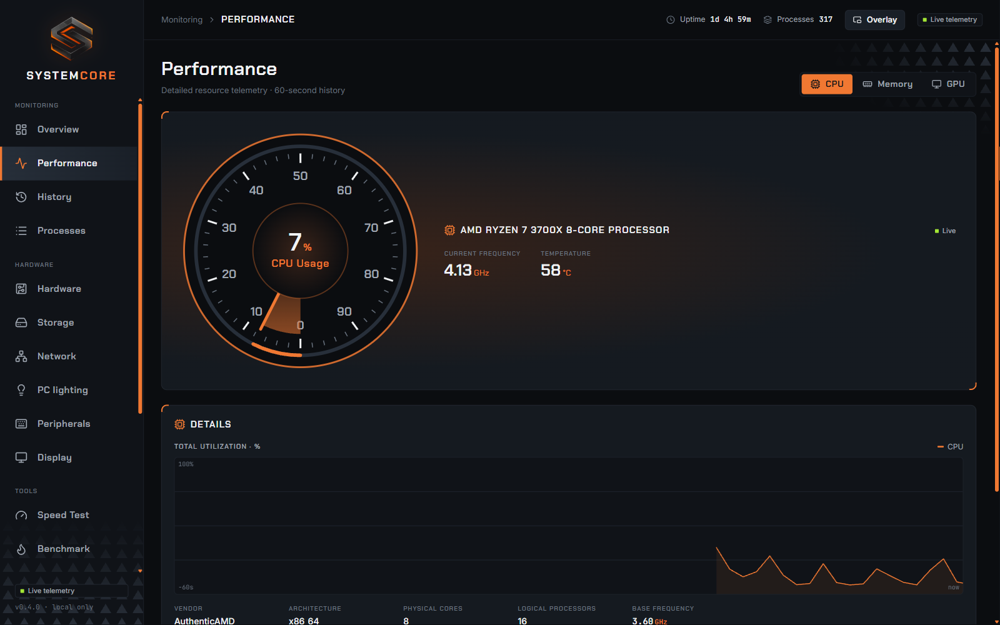
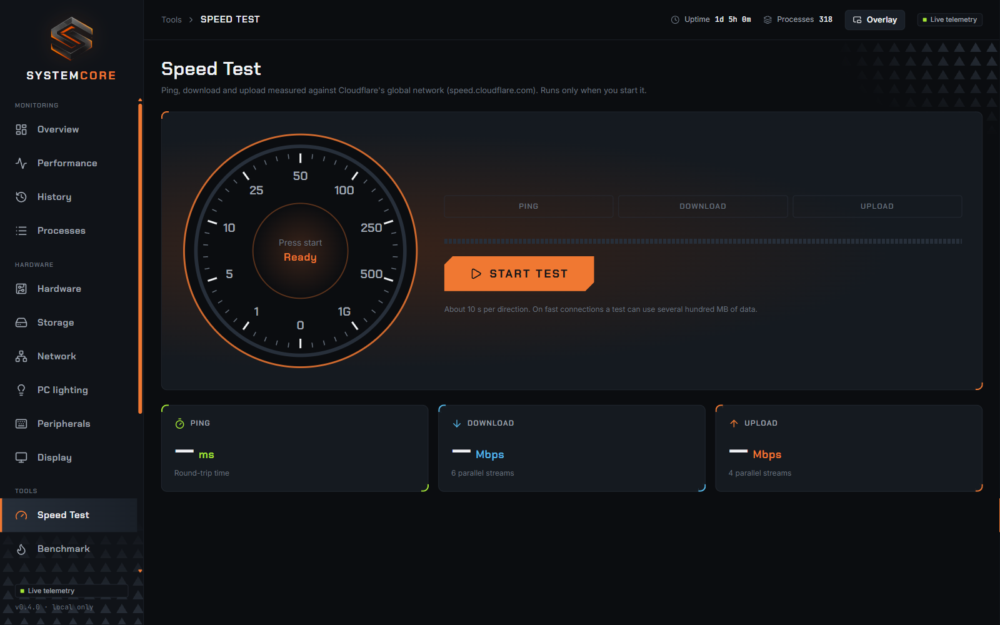

<div align="center">


# SystemCore

**A fast, good-looking system monitor for Windows 11.**
Live CPU, GPU, memory, disk and network telemetry in a gaming-cockpit interface, with an in-game overlay, RGB lighting control for PC parts and peripherals, display color profiles for games, a built-in speed test and one-click updates.

[](https://github.com/markbressel/systemcore/releases/latest)


</div>

---

## Download

1. Open the **[latest release](https://github.com/markbressel/systemcore/releases/latest)** and download `SystemCore_<version>_x64-setup.exe`.
2. Run the installer. Windows SmartScreen may say *"Windows protected your PC"* because the installer is not code-signed with a paid certificate. Click **More info → Run anyway**.
3. That's it. Future versions install from inside the app (see [Updates](#updates)).

No account and no background services. The installer also offers **PawnIO**, a small signed hardware driver used for RAM lighting and the CPU temperature; you can decline it in its own prompt and everything else still works (see [Hardware access](#hardware-access-pawnio)).

## Features

| | |
|---|---|
| **Overview** | Cockpit dashboard: CPU and GPU dials with car-style temperature gauges, memory usage with a selectable info line (uptime, GPU power, ping, processes), disk space, clocks and fan speed at a glance. |
| **Performance** | Per-resource detail for CPU, memory and GPU with a 60-second live history chart. |
| **History** | Load, temperatures, memory, network, ping and FPS over the last 1, 6 or 24 hours. |
| **Processes** | Searchable, sortable process list (`Ctrl+F`), process details, priority, open file location, search online and **End process** with confirmation. |
| **Hardware** | Processor, motherboard, memory modules and graphics card inventory. **Copy specs** or **Save report** for forums and support. |
| **Storage** | Every volume with capacity, live read/write speed and drive health. Windows notification if a drive's health gets worse. |
| **Network** | Total and per-adapter download/upload rates with history. |
| **PC lighting** | 3D model of a PC: take the side panel off, lift a part out and set its RGB color. RAM lighting (ENE controllers such as T-Force Delta RGB) works without vendor software. |
| **Peripherals** | 3D desk with keyboard, mouse, headset and mouse pad: pick a device up and color it. Supports Windows Dynamic Lighting, Logitech G (wired and Lightspeed), Razer Chroma and VIA/QMK keyboards (Keychron and others). One switch makes every device follow the app's accent color. |
| **Display** | Brightness, contrast, gamma, color temperature and NVIDIA saturation (digital vibrance) per monitor, plus the monitor's own backlight over DDC/CI. **Game profiles** switch on by themselves while a game is in front. |
| **Speed Test** | Ping, jitter, download and upload against Cloudflare's global network. Runs only when you press start. |
| **Startup Apps** | Programs that start with Windows, with an on/off switch that works like Task Manager's. |
| **Overlay** | Always-on-top gaming overlay: FPS, frame time and 1% low, CPU, GPU, RAM, network and ping. `Ctrl+Shift+O` shows or hides it from anywhere, and it can open by itself when a game goes fullscreen. |
| **Settings** | Overlay readings, size, compact layout and placement; start with Windows; keep running in the tray. |
| **Alerts** | Optional Windows notifications when CPU or GPU temperature or RAM usage reaches your limit, or when one program keeps using a lot of CPU or memory. |
| **Tray** | SystemCore keeps running in the notification area: open it, toggle the overlay or quit from the tray icon. |
| **Updates** | An **Update** button appears when a new version is out. One click downloads, installs and restarts. |

The **Benchmark**, **Storage** cleanup and the health score live under their own pages too.

## Screenshots

<table>
  <tr>
    <td width="50%"><p align="center"><b>Performance</b>: live history per resource</p></td>
    <td width="50%"><p align="center"><b>Processes</b>: search, sort, details, end process</p></td>
  </tr>
  <tr>
    <td width="50%"><p align="center"><b>Hardware</b>: full inventory</p></td>
    <td width="50%"><p align="center"><b>Speed Test</b>: ping, download, upload</p></td>
  </tr>
</table>

### In-game overlay


Turn it on from the top bar (**Overlay**), the tray icon, **Settings**, or with `Ctrl+Shift+O`.

- FPS, frame time and 1% low of the app in front (needs administrator, see below).
- CPU load and clock, GPU load, temperature, VRAM and power draw, RAM usage, live network rates and ping.
- **Show overlay in games**: opens by itself when an app goes fullscreen and closes when you leave.
- **Readings and size**: pick CPU, GPU, RAM and network, scale it 75–150 %, or switch to a single-line **compact** layout.
- **Fixed position**: pin it to any corner of the screen. It respects the taskbar.
- **Free positioning**: drag it anywhere, then tick **Locked** so it stays put, even after a restart.

The overlay is visible over games running in *windowed* or *borderless* mode. Exclusive fullscreen draws over every other window.

<br clear="right" />


## Updates

SystemCore checks GitHub Releases at startup and every 6 hours. When a newer version exists, an orange **Update to x.y.z** button appears in the top bar. Clicking it downloads the installer, verifies its signature and restarts into the new version.

Every update is signed. The app refuses any installer that was not signed with the project's private key, so a tampered download cannot be installed.

## Hardware access (PawnIO)

Windows does not let ordinary programs read the Ryzen CPU temperature or talk to the motherboard's SMBus, where RAM lighting controllers sit. For these two features SystemCore uses [PawnIO](https://pawnio.eu), a signed open hardware-access driver also used by LibreHardwareMonitor and OpenRGB.

- The SystemCore installer runs the official PawnIO setup silently (it asks for administrator rights itself) and skips it when PawnIO is already installed. Uninstalling SystemCore leaves PawnIO in place, because other tools may use it.
- RAM lighting and the CPU temperature need SystemCore to **run as administrator**; the PC lighting page offers a restart button.
- Safety: RAM controllers are identified with read-only checks first; SystemCore only ever writes color, mode and apply registers, never to the memory's SPD chip, and never saves to the controller's flash.

## Privacy

Everything is measured and shown locally. SystemCore has no account, no analytics and sends no telemetry. It makes only two kinds of network requests:

- the **Speed Test**, and only when you start it (Cloudflare);
- the **ping** reading: a TCP handshake to `1.1.1.1:443` every 2 seconds, without sending any data;
- the **update check** (GitHub Releases).

History stays in memory on this PC and is gone when SystemCore quits. Lighting and display settings are saved on this PC only. The spec report leaves out the computer name and MAC addresses.

Process command lines and environment variables are never read.

---

## Building from source

**Requirements:** Node 20+, Rust (stable, MSVC toolchain), Visual Studio Build Tools (C++ workload), WebView2 (built into Windows 11).

```powershell
npm install
npm run app        # development: Vite + Tauri window with hot reload
npm test           # Rust unit tests + UI self-checks
npx tauri build    # NSIS installer in src-tauri/target/release/bundle/nsis/
```

### Releasing a new version

1. Bump the version in `package.json`, `src-tauri/Cargo.toml` and `src-tauri/tauri.conf.json` (then `npm install --package-lock-only` so the lockfile follows).
2. Update this README: the feature table, anything that changed for users, and screenshots when the UI changed.
3. Commit, then tag and push:
   ```powershell
   git tag vX.Y.Z
   git push origin main vX.Y.Z
   ```
4. The [Release workflow](.github/workflows/release.yml) builds and signs the installer and publishes the GitHub Release together with `latest.json`. Installed apps pick it up automatically.

The workflow needs the repository secret `TAURI_SIGNING_PRIVATE_KEY`, the updater signing key. Never commit it.

## Architecture

```
React pages (src/features/*)
  └─ stores (src/stores/*)  ─ telemetry, settings, updates; one subscription shared by every page
       └─ src/lib/tauri.ts  ─ the only module that talks to Rust
            └─ Rust commands + events (telemetry:system | processes | disks)
                 └─ collector.rs ─ one background thread on a fixed schedule
                      └─ sysinfo, PDH, NVML, WMI (src-tauri/src/platform/windows)
```

- **Tech:** Tauri 2, Rust, React 19, TypeScript, SCSS (BEM, design tokens as CSS custom properties). Fonts are bundled (Inter, JetBrains Mono, Chakra Petch) and icons come from `lucide-react`.
- **Contract:** `src-tauri/src/domain.rs` ⇄ `src/types/telemetry.ts`. Every metric carries `status`, `source` and `sampledAt`; a missing value is `null`, never a fake `0`.
- **Cadence:** CPU and network every 1 s; memory, processes, GPU and disks every 2 s; temperature every 5 s; drive health every 60 s.
- **Rates** come from cumulative counters. A counter going backwards gives "temporarily unavailable" instead of a spike.
- **Design:** see [Design-work.md](Design-work.md). Full product spec: [SystemCore-work.md](SystemCore-work.md).

### Data sources

All sources work without administrator rights, except FPS.

| Data | Source |
|---|---|
| CPU effective and base clock | PDH `Processor Information` (Task Manager's method) |
| Committed memory / commit limit | `GetPerformanceInfo` |
| GPU dedicated and shared memory | PDH `GPU Adapter Memory` |
| NVIDIA temperature, clocks, power, fan, VRAM | NVML (`nvml.dll` from the driver, loaded at runtime) |
| Drive health and media type | WMI Storage Management (`MSFT_PhysicalDisk`) |
| RAM modules | WMI `Win32_PhysicalMemory` |
| CPU temperature | LibreHardwareMonitor's WMI namespace, while it is running |
| FPS, frame time, 1% low | ETW present events (DXGI, D3D9, DxgKrnl), like PresentMon. Needs administrator |
| Ping | TCP connect time to Cloudflare (`1.1.1.1:443`) |
| Startup apps | `Run` registry keys, Startup folders and Task Manager's `StartupApproved` flags |

### Known limitations

- **CPU temperature** needs [LibreHardwareMonitor](https://github.com/LibreHardwareMonitor/LibreHardwareMonitor) running. Windows exposes no CPU die temperature to normal apps on most desktops, and reading it directly needs a kernel driver, which SystemCore deliberately does not install.
- **GPU temperature, clocks, power and fan** are NVIDIA-only for now.
- **FPS** needs SystemCore to run as administrator (**Settings → Gaming → Restart as administrator**): Windows only shares other programs' frame events with elevated apps. It counts the frames the game hands to Windows, so it matches PresentMon-style tools, not the in-game counter of every engine.
- **Exclusive fullscreen** games draw over every window, including the overlay. Use borderless or windowed mode.
- **Process memory** is the working set. Task Manager's default column is the private working set, so the numbers differ.
- Some older drives report no media type ("Unspecified by drive").

## Third-party software

- [PawnIO](https://pawnio.eu) driver setup (freeware, redistributed with the author's permission for its installer) and its modules from [PawnIO.Modules](https://github.com/namazso/PawnIO.Modules) (LGPL-2.1, unmodified; license text in `src-tauri/resources/pawnio/COPYING`).
- Lighting protocols are SystemCore's own implementation; the OpenRGB, openrazer and liquidctl projects were used as protocol documentation only.
