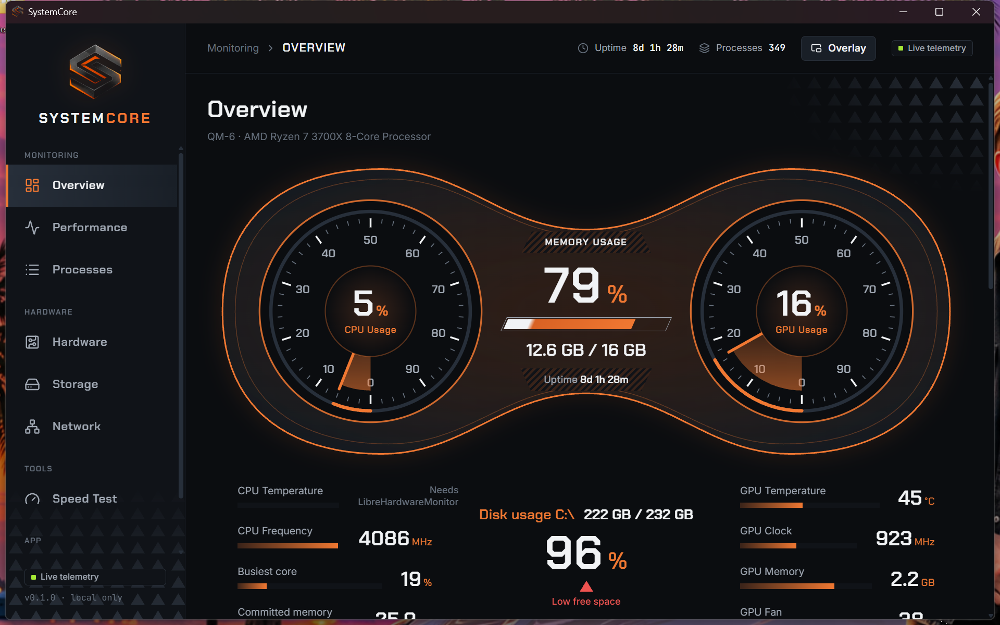
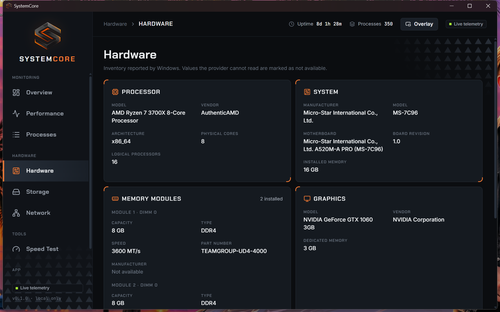
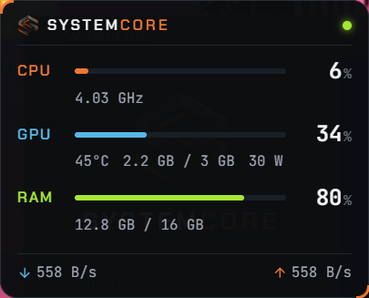

<div align="center">


# SystemCore

**A fast, good-looking system monitor for Windows 11.**
Live CPU, GPU, memory, disk and network telemetry in a gaming-cockpit interface, with an in-game overlay, a built-in speed test and one-click updates.

[](https://github.com/markbressel/systemcore/releases/latest)




</div>

---

## Download

1. Open the **[latest release](https://github.com/markbressel/systemcore/releases/latest)** and download `SystemCore_<version>_x64-setup.exe`.
2. Run the installer. Windows SmartScreen may say *"Windows protected your PC"* because the installer is not code-signed with a paid certificate. Click **More info → Run anyway**.
3. That's it. Future versions install from inside the app (see [Updates](#updates)).

No administrator rights, no drivers, no background services.

## Features

| | |
|---|---|
| **Overview** | Cockpit dashboard: CPU and GPU dials, memory usage, disk space, temperatures, clocks and fan speed at a glance. |
| **Performance** | Per-resource detail for CPU, memory and GPU with a 60-second live history chart. |
| **Processes** | Searchable, sortable process list (`Ctrl+F`), process details and **End process** with confirmation. |
| **Hardware** | Processor, motherboard, memory modules and graphics card inventory. |
| **Storage** | Every volume with capacity, live read/write speed and drive health. Windows notification if a drive's health gets worse. |
| **Network** | Total and per-adapter download/upload rates with history. |
| **Speed Test** | Ping, jitter, download and upload against Cloudflare's global network. Runs only when you press start. |
| **Overlay** | Small always-on-top window with CPU, GPU, RAM and network for gaming. |
| **Settings** | Overlay placement: pinned to a corner, or dragged freely and locked in place. |
| **Updates** | An **Update** button appears when a new version is out. One click downloads, installs and restarts. |

## Screenshots

<table>
  <tr>
    <td width="50%"><p align="center"><b>Performance</b>: live history per resource</p></td>
    <td width="50%"><p align="center"><b>Processes</b>: search, sort, details, end process</p></td>
  </tr>
  <tr>
    <td width="50%"><p align="center"><b>Hardware</b>: full inventory</p></td>
    <td width="50%"><p align="center"><b>Speed Test</b>: ping, download, upload</p></td>
  </tr>
</table>

### In-game overlay



Turn it on from the top bar (**Overlay**) or from **Settings**.

- CPU load and clock, GPU load, temperature, VRAM and power draw, RAM usage and live network rates.
- **Fixed position**: pin it to any corner of the screen. It respects the taskbar.
- **Free positioning**: drag it anywhere, then tick **Locked** so it stays put, even after a restart.

The overlay is visible over games running in *windowed* or *borderless* mode. Exclusive fullscreen draws over every other window.

<br clear="right" />


## Updates

SystemCore checks GitHub Releases at startup and every 6 hours. When a newer version exists, an orange **Update to x.y.z** button appears in the top bar. Clicking it downloads the installer, verifies its signature and restarts into the new version.

Every update is signed. The app refuses any installer that was not signed with the project's private key, so a tampered download cannot be installed.

## Privacy

Everything is measured and shown locally. SystemCore has no account, no analytics and sends no telemetry. It makes only two kinds of network requests:

- the **Speed Test**, and only when you start it (Cloudflare);
- the **update check** (GitHub Releases).

Process command lines and environment variables are never read.

---

## Building from source

**Requirements:** Node 20+, Rust (stable, MSVC toolchain), Visual Studio Build Tools (C++ workload), WebView2 (built into Windows 11).

```powershell
npm install
npm run app        # development: Vite + Tauri window with hot reload
npm test           # Rust unit tests + UI self-checks
npx tauri build    # NSIS installer in src-tauri/target/release/bundle/nsis/
```

### Releasing a new version

1. Bump the version in `package.json`, `src-tauri/Cargo.toml` and `src-tauri/tauri.conf.json`.
2. Commit, then tag and push:
   ```powershell
   git tag v0.2.0
   git push origin main v0.2.0
   ```
3. The [Release workflow](.github/workflows/release.yml) builds and signs the installer and publishes the GitHub Release together with `latest.json`. Installed apps pick it up automatically.

The workflow needs the repository secret `TAURI_SIGNING_PRIVATE_KEY`, the updater signing key. Never commit it.

## Architecture

```
React pages (src/features/*)
  └─ stores (src/stores/*)  ─ telemetry, settings, updates; one subscription shared by every page
       └─ src/lib/tauri.ts  ─ the only module that talks to Rust
            └─ Rust commands + events (telemetry:system | processes | disks)
                 └─ collector.rs ─ one background thread on a fixed schedule
                      └─ sysinfo, PDH, NVML, WMI (src-tauri/src/platform/windows)
```

- **Tech:** Tauri 2, Rust, React 19, TypeScript, SCSS (BEM, design tokens as CSS custom properties). Fonts are bundled (Inter, JetBrains Mono, Chakra Petch) and icons come from `lucide-react`.
- **Contract:** `src-tauri/src/domain.rs` ⇄ `src/types/telemetry.ts`. Every metric carries `status`, `source` and `sampledAt`; a missing value is `null`, never a fake `0`.
- **Cadence:** CPU and network every 1 s; memory, processes, GPU and disks every 2 s; temperature every 5 s; drive health every 60 s.
- **Rates** come from cumulative counters. A counter going backwards gives "temporarily unavailable" instead of a spike.
- **Design:** see [Design-work.md](Design-work.md). Full product spec: [SystemCore-work.md](SystemCore-work.md).

### Data sources

All sources work without administrator rights.

| Data | Source |
|---|---|
| CPU effective and base clock | PDH `Processor Information` (Task Manager's method) |
| Committed memory / commit limit | `GetPerformanceInfo` |
| GPU dedicated and shared memory | PDH `GPU Adapter Memory` |
| NVIDIA temperature, clocks, power, fan, VRAM | NVML (`nvml.dll` from the driver, loaded at runtime) |
| Drive health and media type | WMI Storage Management (`MSFT_PhysicalDisk`) |
| RAM modules | WMI `Win32_PhysicalMemory` |
| CPU temperature | LibreHardwareMonitor's WMI namespace, while it is running |

### Known limitations

- **CPU temperature** needs [LibreHardwareMonitor](https://github.com/LibreHardwareMonitor/LibreHardwareMonitor) running. Windows exposes no CPU die temperature to normal apps on most desktops, and reading it directly needs a kernel driver, which SystemCore deliberately does not install.
- **GPU temperature, clocks, power and fan** are NVIDIA-only for now.
- **FPS** is not shown in the overlay. Measuring another program's frame rate needs Windows event tracing with administrator rights.
- **Process memory** is the working set. Task Manager's default column is the private working set, so the numbers differ.
- Some older drives report no media type ("Unspecified by drive").
