<div align="center">


# SystemCore

**A fast, good-looking system monitor and PC control center for Windows 11.**
Live CPU, GPU, memory, disk and network telemetry in a gaming-cockpit interface, an in-game overlay with FPS,
RGB lighting control for PC parts and peripherals, display color profiles for games, a "will this game run?" check,
one-click updates for all your programs, a gamer's app loadout, IT and gaming news, a speed test and a benchmark.

<br />

<a href="https://github.com/markbressel/systemcore/releases/latest"></a>

<br />

[](https://github.com/markbressel/systemcore/releases/latest)
[](https://github.com/markbressel/systemcore/releases)


</div>

---

## What's new in 0.4.0

- **Will this game run?** (Benchmark page): search any game on Steam and see its minimum and recommended specs next to your PC, how it would run, and exactly which part to upgrade.
- **Updater**: every installed program with an update, the download size and how full your Windows drive would get, then update them all in one go (Windows Package Manager).
- **Loadout**: game launchers, voice and streaming apps, monitoring and cleanup tools with their real icons, plus the drivers and vendor tools picked for *your* graphics card, processor, motherboard and mouse. One click installs them silently.
- **News**: the latest IT, hardware and gaming news from Hungarian and English sites, and a "What's new in SystemCore" timeline.
- **About** page with a feedback form: bug reports and ideas reach the developer directly.
- **More RGB hardware**: ASRock Polychrome and Gigabyte RGB Fusion motherboards (with the fans and coolers on their headers, e.g. Deepcool), Gigabyte AORUS and ASRock Radeon graphics cards, newer Logitech mice and keyboards, Logitech keyboards and Bluetooth devices, single-color Keychron backlights.
- **Overlay**: CPU and GPU temperature shown big next to the label, in red when the part runs hot.
- **Safety**: no SMBus lighting access on DDR5 systems; Logitech colors are no longer saved to the device's memory.
- One consistent look for bars, inputs, checkboxes and loading indicators on every page.

All releases and their notes: [Releases](https://github.com/markbressel/systemcore/releases). The app's **News** page shows the same changelog.

## Download and install

1. Click **[Download for Windows](https://github.com/markbressel/systemcore/releases/latest)** and download `SystemCore_<version>_x64-setup.exe`.
2. Run the installer. Windows SmartScreen may say *"Windows protected your PC"* because the installer is not code-signed with a paid certificate. Click **More info → Run anyway**.
3. The installer also offers **PawnIO**, a small signed hardware driver used for RAM lighting and the Ryzen CPU temperature. It asks for administrator rights in its own prompt; if you decline, everything else still works (see [Hardware access](#hardware-access-pawnio)).
4. Done. Future versions install from inside the app (see [Updates](#updates)).

No account, no ads, no telemetry, no background services.

## Features

### Monitoring

<table>
  <tr>
    <td width="50%"></td>
    <td width="50%">
      <b>Overview</b>: the cockpit. CPU and GPU dials with car-style temperature gauges, memory in the middle with a selectable info line (uptime, GPU power, ping, process count), CPU clock, busiest core, committed memory, disk space, GPU clock, memory and fan.<br /><br />
      <b>PC health</b> score with the reasons behind it, <b>Why is it slow?</b> diagnosis, and the top processes.
    </td>
  </tr>
  <tr>
    <td width="50%"></td>
    <td width="50%"><b>Performance</b>: CPU, memory and GPU in detail with a 60-second live history, per-core load, clocks, temperatures, VRAM and power.</td>
  </tr>
  <tr>
    <td width="50%">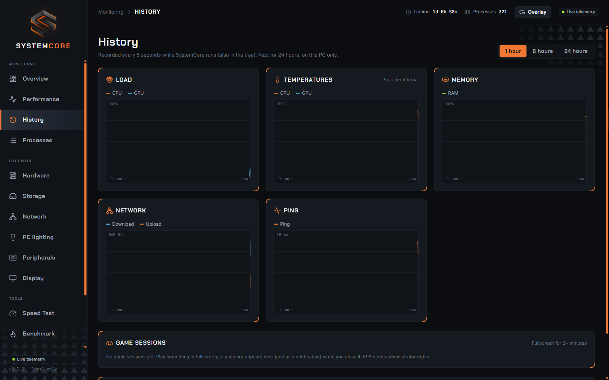</td>
    <td width="50%"><b>History</b>: load, temperatures, memory, network, ping and FPS over the last 1, 6 or 24 hours, recorded every 5 seconds while SystemCore runs (also from the tray).</td>
  </tr>
  <tr>
    <td width="50%">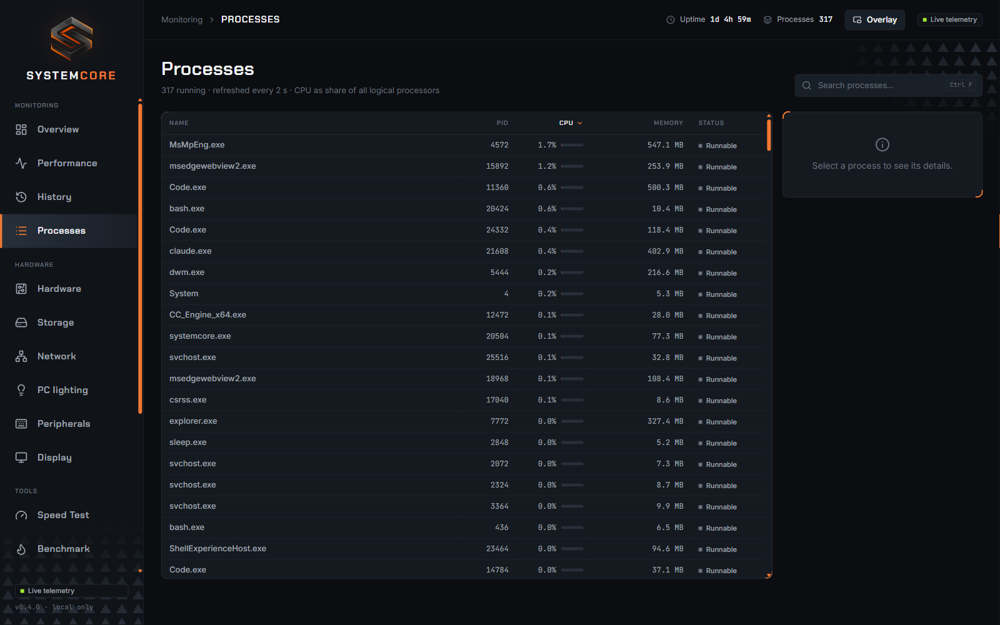</td>
    <td width="50%"><b>Processes</b>: searchable, sortable list (<code>Ctrl+F</code>), details, priority, open file location, search online and <b>End process</b> with confirmation.</td>
  </tr>
</table>

<table>
  <tr>
    <td width="33%">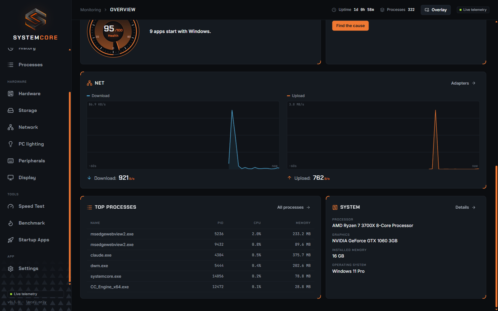<p align="center">Overview: health, diagnosis, top processes</p></td>
    <td width="33%">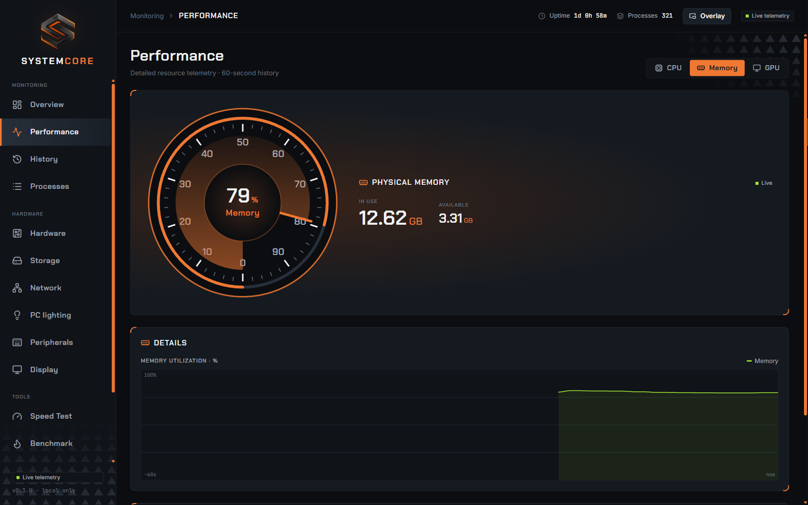<p align="center">Performance: memory</p></td>
    <td width="33%">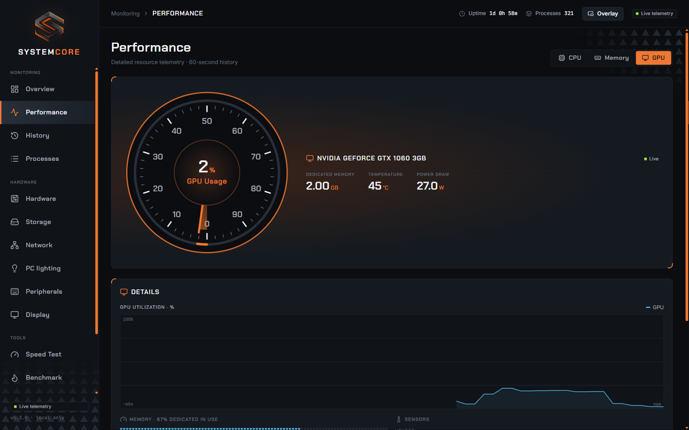<p align="center">Performance: GPU</p></td>
  </tr>
</table>

### Hardware

<table>
  <tr>
    <td width="50%"></td>
    <td width="50%"><b>Hardware</b>: processor, motherboard, memory modules and graphics card inventory. <b>Copy specs</b> or <b>Save report</b> for forums and support (without the computer name and MAC addresses).</td>
  </tr>
  <tr>
    <td width="50%">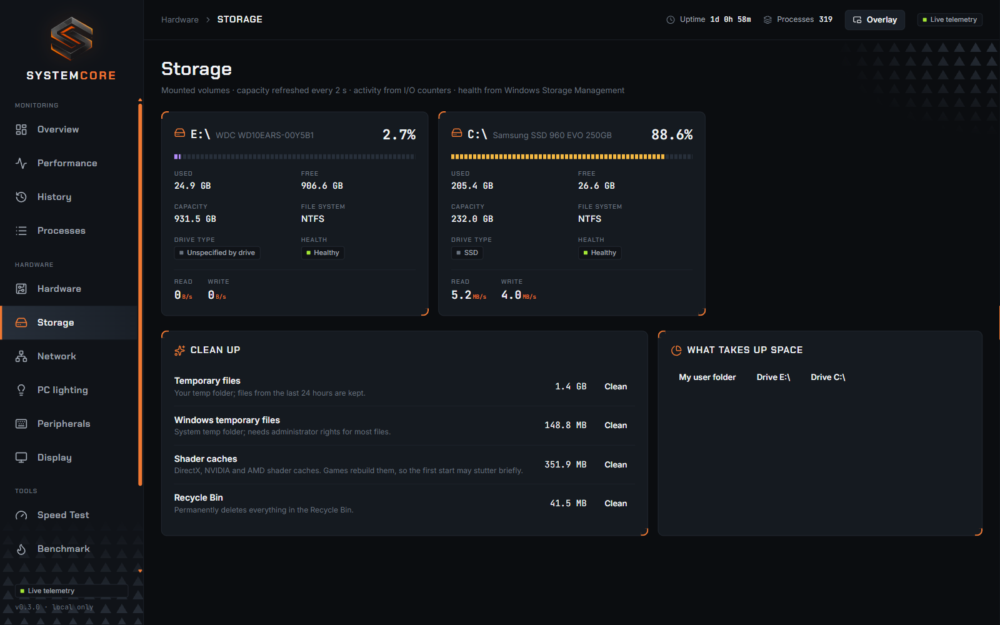</td>
    <td width="50%"><b>Storage</b>: every volume with capacity, live read/write speed and drive health, a Windows notification if a drive's health gets worse, folder sizes, and <b>cleanup</b> of temporary files and caches.</td>
  </tr>
  <tr>
    <td width="50%">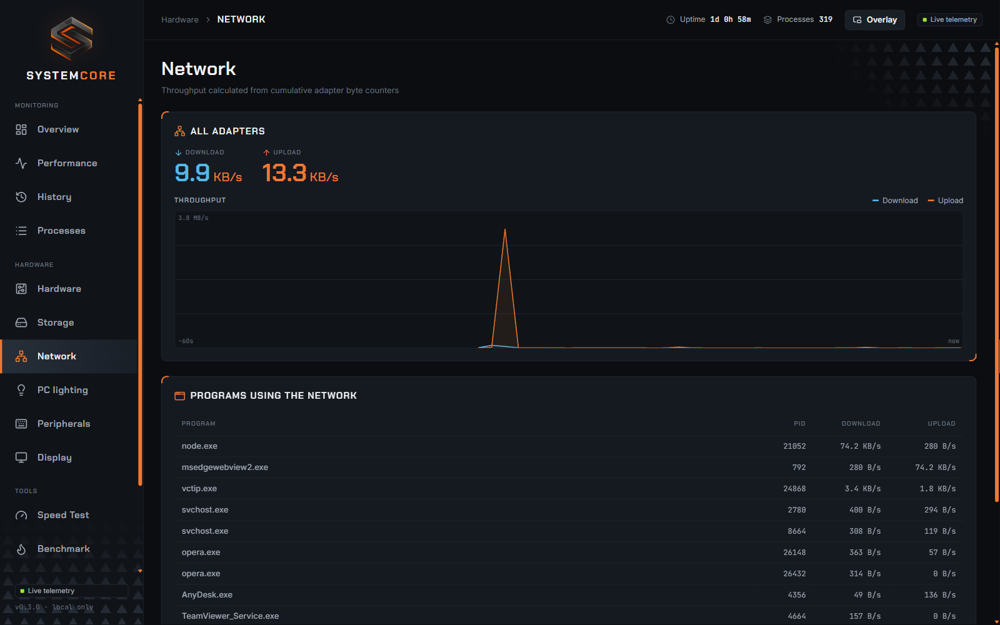</td>
    <td width="50%"><b>Network</b>: total and per-adapter download/upload rates with history, and the programs using the network (a steady snapshot with a <b>Refresh</b> button, so the list doesn't jump around).</td>
  </tr>
  <tr>
    <td width="50%">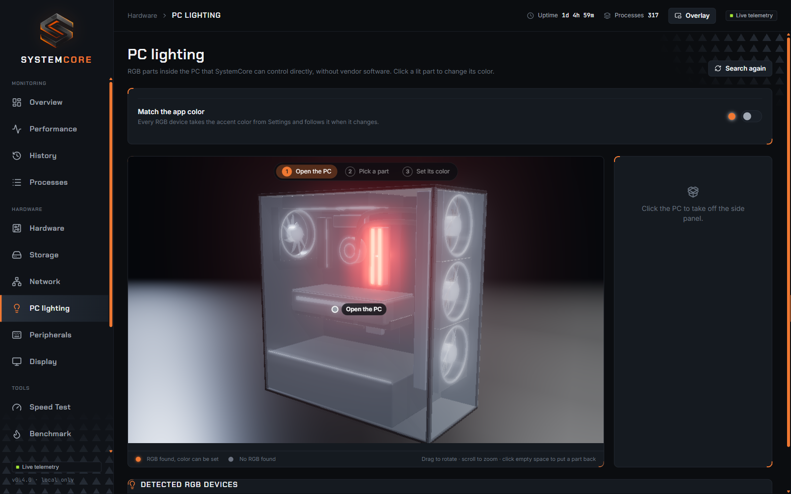</td>
    <td width="50%">
      <b>PC lighting</b>: a 3D mid-tower you can rotate and take apart. Click the PC to take the glass panel off, click a part (graphics card, RAM, motherboard, cooler, fans, LED strip) to lift it out, then set its color. Pulsing hotspots show what can be clicked; colored ones have RGB that SystemCore found.
    </td>
  </tr>
  <tr>
    <td width="50%">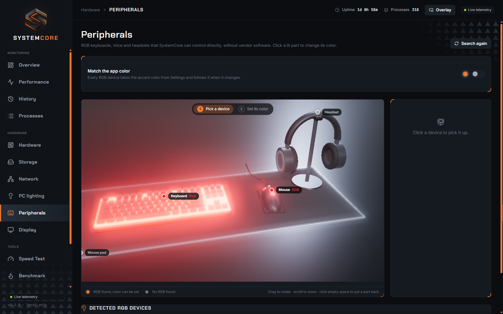</td>
    <td width="50%"><b>Peripherals</b>: a 3D desk with keyboard, mouse, headset and mouse pad. Pick a device up to color it. <b>Match the app color</b> makes every RGB device follow the accent color from Settings.</td>
  </tr>
  <tr>
    <td width="50%">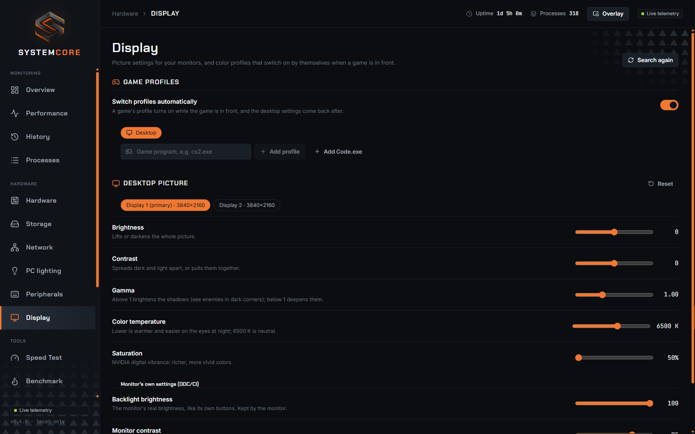</td>
    <td width="50%">
      <b>Display</b>: brightness, contrast, gamma (see into dark corners) and color temperature on any GPU, saturation (NVIDIA digital vibrance), and the monitor's own backlight and contrast over DDC/CI.<br /><br />
      <b>Game profiles</b>: one set of colors per game (e.g. <code>cs2.exe</code>), switched on automatically while the game is in front and back to the desktop settings after. Editing a profile shows it live.
    </td>
  </tr>
</table>

**Taking the PC apart, step by step:**

<table>
  <tr>
    <td width="25%"><p align="center">1. Click the PC</p></td>
    <td width="25%">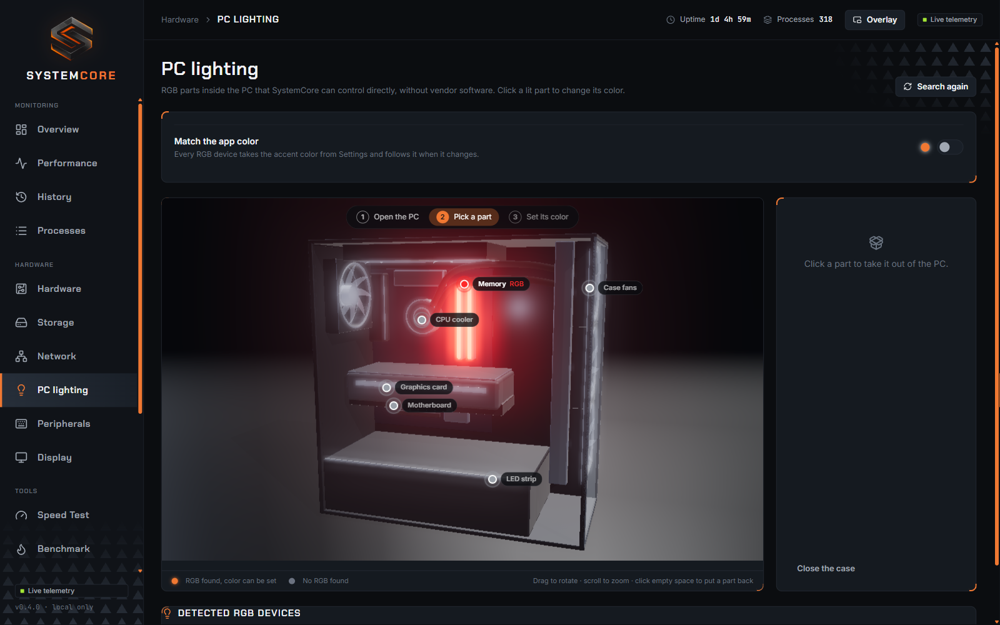<p align="center">2. Pick a part</p></td>
    <td width="25%">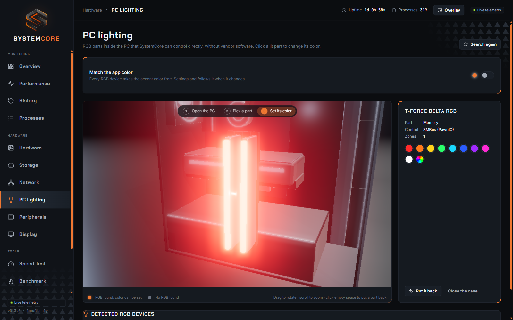<p align="center">3. Set its color</p></td>
    <td width="25%">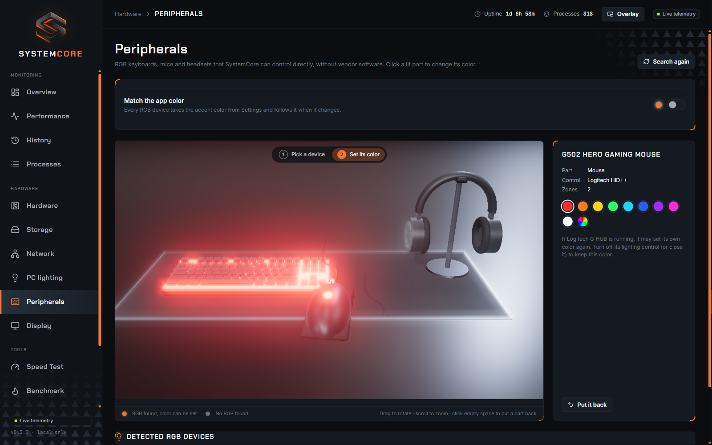<p align="center">Peripherals: a picked-up mouse</p></td>
  </tr>
</table>

### Tools

<table>
  <tr>
    <td width="50%"></td>
    <td width="50%"><b>Speed Test</b>: ping, jitter, download and upload against Cloudflare's global network. Runs only when you press start.</td>
  </tr>
  <tr>
    <td width="50%">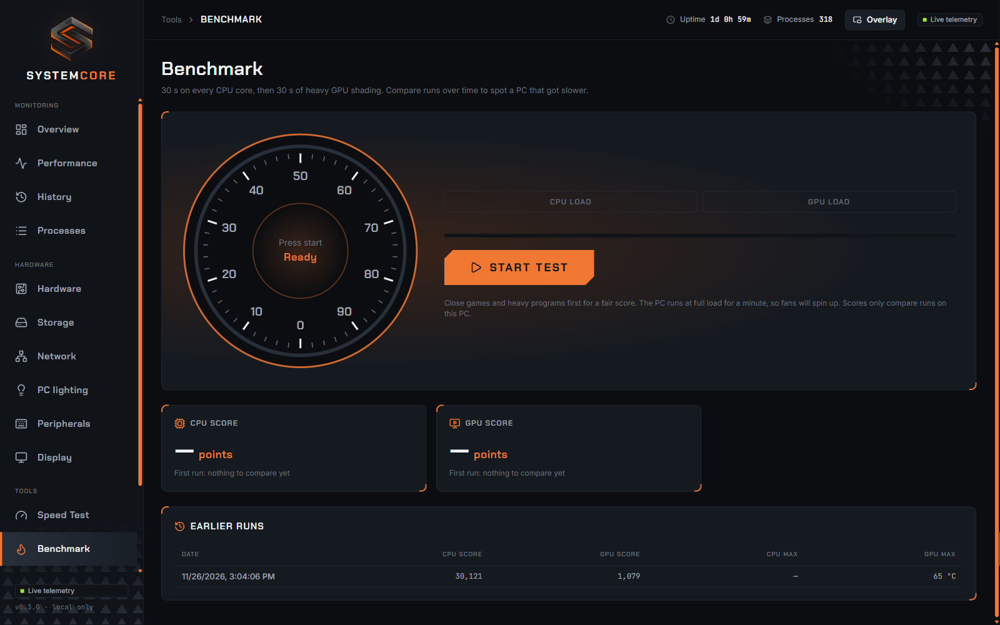</td>
    <td width="50%"><b>Benchmark</b>: 30 s CPU and 30 s GPU stress test with scores, the temperature during the run, thermal slow-down detection and earlier runs to compare.</td>
  </tr>
  <tr>
    <td width="50%">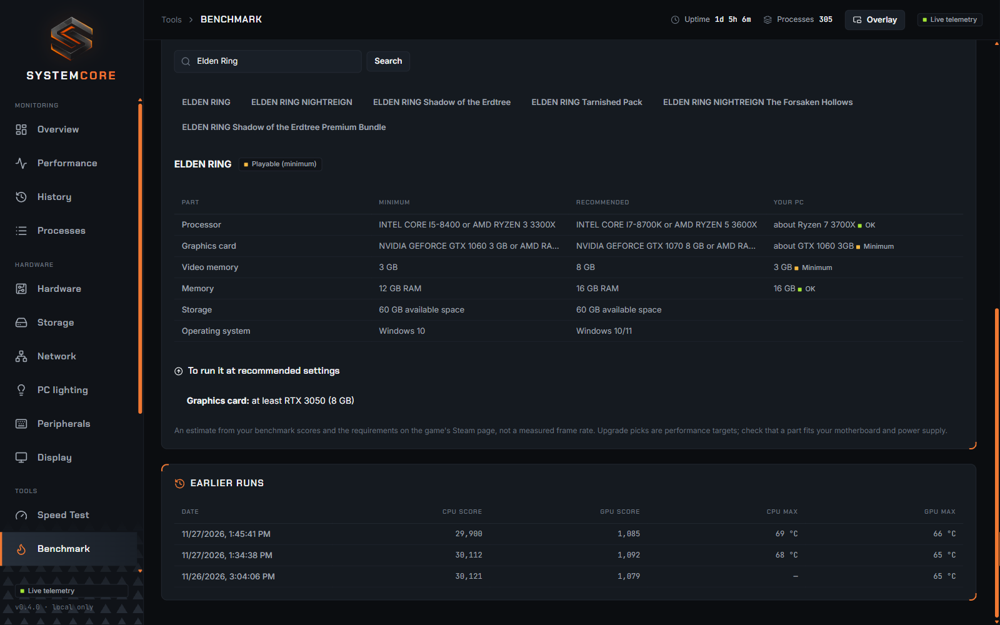</td>
    <td width="50%">
      <b>Will this game run?</b>: search any game on Steam. SystemCore reads its minimum and recommended requirements, puts them next to your PC (processor, graphics card, video memory, RAM, storage, Windows) and says <i>Runs well</i>, <i>Playable</i> or <i>Below minimum</i>, part by part.<br /><br />
      Below it: <b>what to upgrade</b> for the recommended settings, naming the cheapest current part that gets there (e.g. "Graphics card: at least RTX 3050 (8 GB)"). Your processor and graphics card are placed on a scale of known parts from your benchmark scores.
    </td>
  </tr>
  <tr>
    <td width="50%">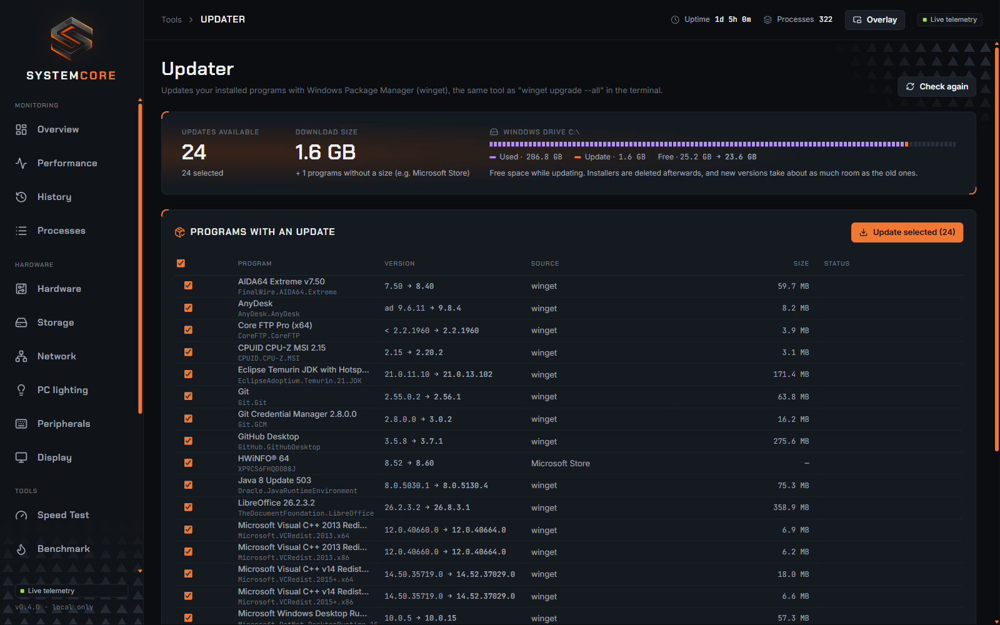</td>
    <td width="50%">
      <b>Updater</b>: every installed program with a newer version (the same list as <code>winget upgrade</code>), with current and new version, source and download size. A drive bar shows how full the Windows drive would get while updating and warns if space runs short.<br /><br />
      <b>Update selected</b> installs them one at a time, silently, with a status per row. It keeps going while you use other pages; <b>Stop after this program</b> never interrupts an installer halfway.
    </td>
  </tr>
  <tr>
    <td width="50%">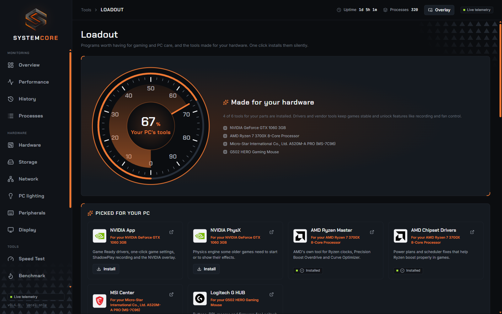</td>
    <td width="50%">
      <b>Loadout</b>: the apps worth having on a gaming PC, with their real icons: game launchers (Steam, Epic, GOG, EA, Ubisoft, Battle.net, Playnite…), voice and streaming (Discord, OBS, Medal…), monitoring and tuning (HWiNFO, MSI Afterburner, CPU-Z, GPU-Z, FanControl…), cleanup and care, and the runtimes games need.<br /><br />
      <b>Picked for your PC</b>: the drivers and vendor tools for the parts SystemCore found (NVIDIA App, Ryzen Master, MSI Center, Logitech G HUB…), with the reason on each card. Installed apps are marked; one click installs the rest silently.
    </td>
  </tr>
  <tr>
    <td width="50%">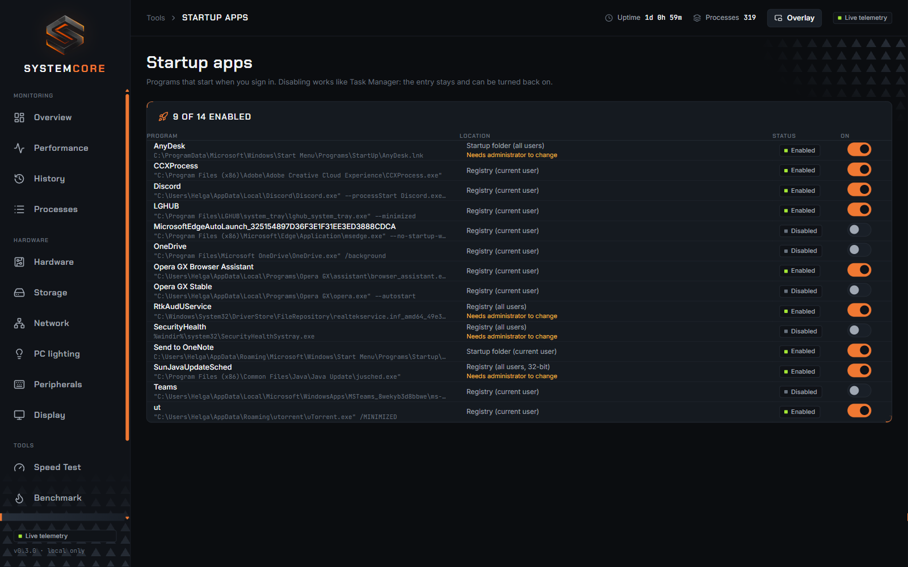</td>
    <td width="50%"><b>Startup apps</b>: programs that start with Windows, with an on/off switch that works like Task Manager's.</td>
  </tr>
  <tr>
    <td width="50%">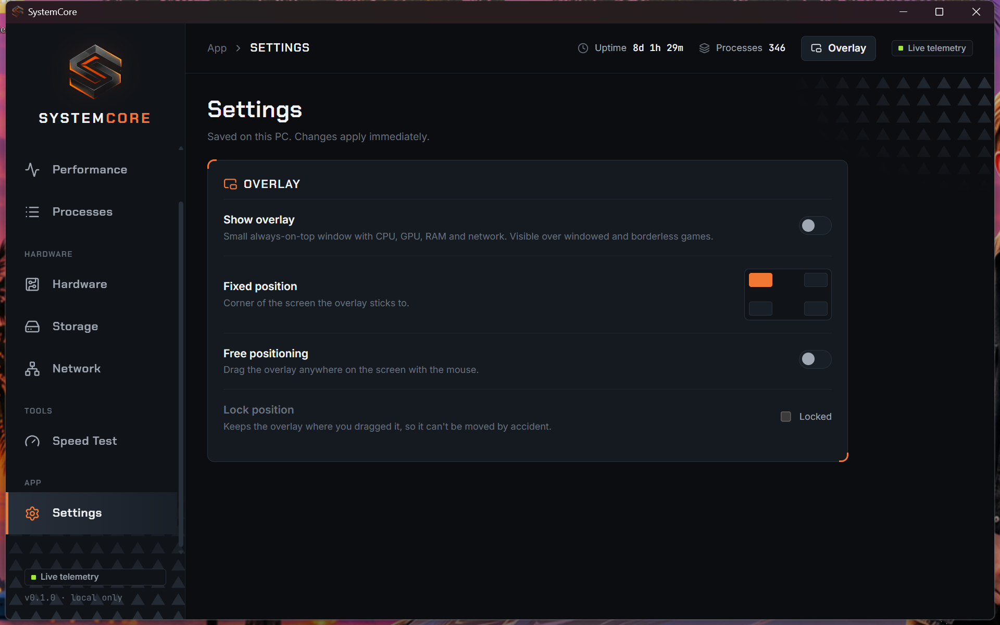</td>
    <td width="50%">
      <b>Settings</b>: startup and tray, overlay layout and position, alerts, gaming (FPS measurement, overlay in games, fullscreen optimizations check, <b>Game mode</b> with high priority and the High performance power plan), and appearance: dark or light theme, accent color, English or Hungarian.
    </td>
  </tr>
</table>

<table>
  <tr>
    <td width="25%">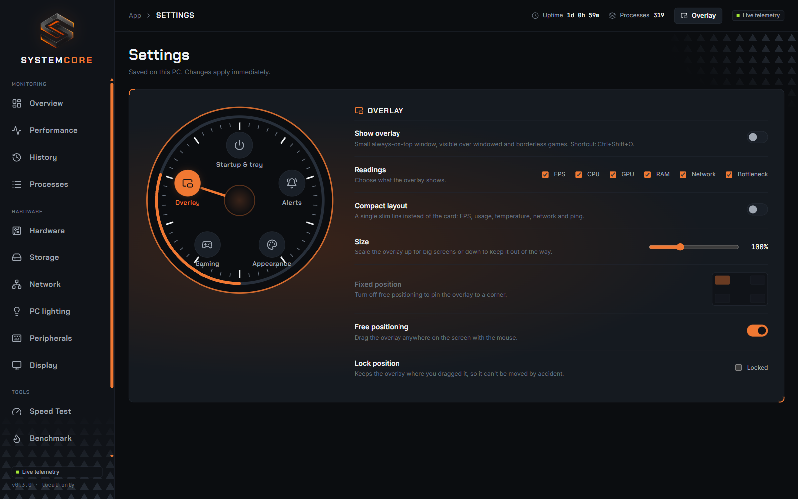<p align="center">Overlay</p></td>
    <td width="25%">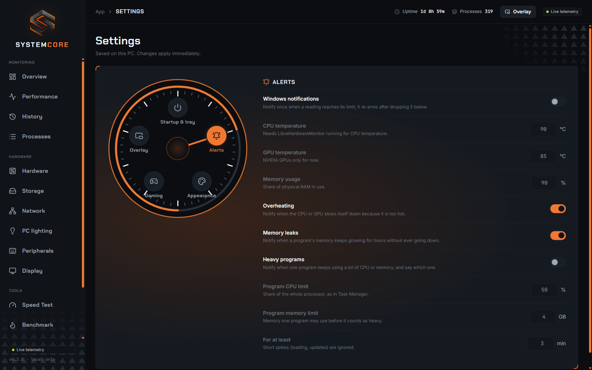<p align="center">Alerts</p></td>
    <td width="25%">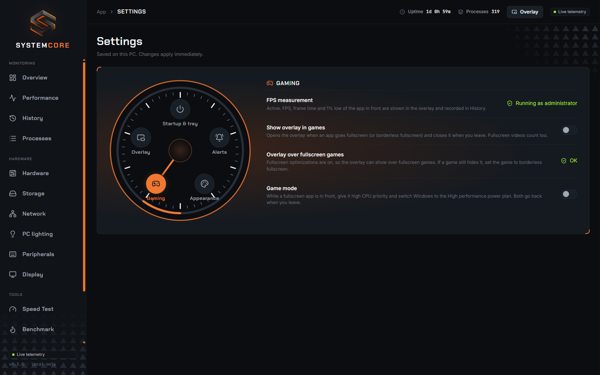<p align="center">Gaming</p></td>
    <td width="25%">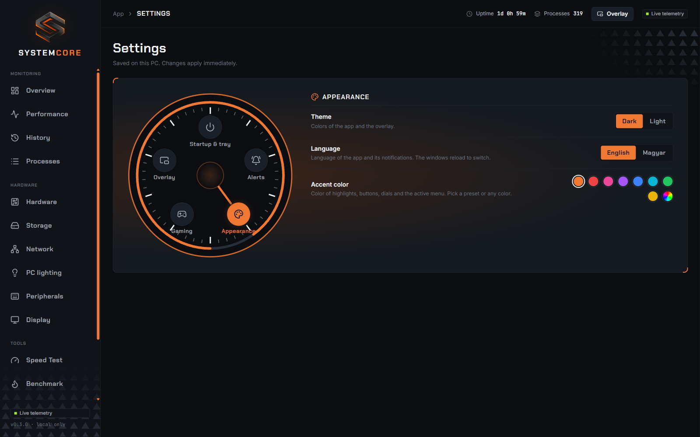<p align="center">Appearance</p></td>
  </tr>
</table>

### News and About

<table>
  <tr>
    <td width="50%">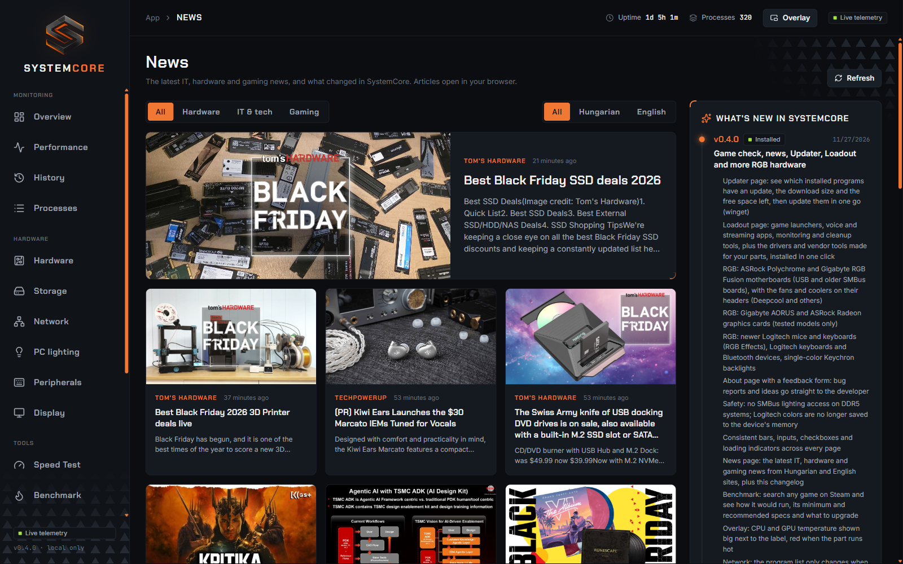</td>
    <td width="50%"><b>News</b>: the latest IT, hardware and gaming news from HWSW, Index Tech, GameStar, Tom's Hardware, TechPowerUp, Ars Technica, PC Gamer and Eurogamer, filtered by topic and language. Driver news for your graphics card is marked. On the side: <b>What's new in SystemCore</b>, every version's changes.</td>
  </tr>
  <tr>
    <td width="50%">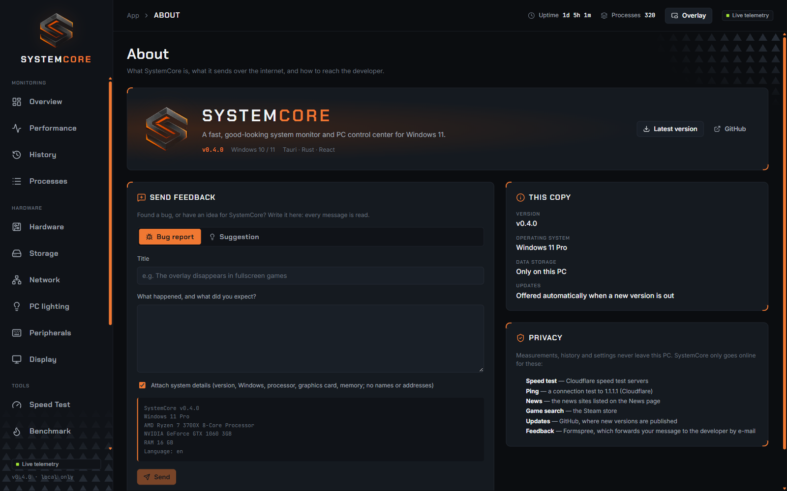</td>
    <td width="50%"><b>About</b>: version, what SystemCore sends over the internet, and a <b>feedback form</b> for bug reports and ideas, sent straight to the developer (system details optional, without names or addresses).</td>
  </tr>
</table>

### In-game overlay


Turn it on from the top bar (**Overlay**), the tray icon, **Settings**, or with `Ctrl+Shift+O`.

- FPS, frame time and 1% low of the app in front (needs administrator, see below).
- CPU and GPU temperature big next to their labels, red when the part runs hot (GPU 83 °C, CPU 90 °C).
- CPU load and clock, GPU load, VRAM and power draw, RAM usage, live network rates and ping.
- **Show overlay in games**: opens by itself when an app goes fullscreen and closes when you leave.
- **Readings and size**: pick the readings, scale it 75–150 %, or switch to a single-line **compact** layout.
- **Fixed position** in any corner (respects the taskbar), or **free positioning** with **Locked** so it stays put.

The overlay shows over games in *windowed* or *borderless* mode. Exclusive fullscreen draws over every other window.

<br clear="right" />

### Alerts, tray and updates

- **Alerts**: optional Windows notifications when CPU or GPU temperature or RAM usage reaches your limit, when one program keeps using a lot of CPU or memory, when memory keeps growing for hours, or when the CPU/GPU slows down from heat.
- **Tray**: SystemCore keeps running in the notification area; open it, toggle the overlay or quit from the tray icon.
- **Updates**: an orange **Update to x.y.z** button appears when a new version is out (see [Updates](#updates)).

## Supported RGB devices

SystemCore talks to the devices directly. No vendor software is needed, but if it runs (G HUB, iCUE, Synapse, MSI Center…) it may set its own colors again; turn off its lighting control to keep SystemCore's.

| Family | Devices | How |
|---|---|---|
| Windows Dynamic Lighting | Any device that supports the Windows 11 lighting standard | Built into Windows; colors apply while SystemCore is in front |
| Logitech G | LIGHTSYNC mice and keyboards: both lighting generations (Color LED effects and the newer RGB effects: G502 X, G915 X, G515, PRO X TKL, G203 LIGHTSYNC…), wired, through Lightspeed/Unifying/Bolt receivers and over Bluetooth, keyboards such as G213, G815 and G915 | USB / Bluetooth (HID++ 2.0) |
| Razer Chroma | BlackWidow, Huntsman, Ornata, Cynosa, DeathAdder, Basilisk, Viper, Naga, Cobra, Firefly, Goliathus, Strider, Tartarus, Chroma docks | USB |
| Keychron and other VIA / QMK keyboards | Keychron Q, V, K Pro, Max and C Pro series and other VIA-enabled keyboards; RGB, or brightness on single-color backlights | USB / Keychron Link (VIA raw HID) |
| ASRock motherboards | Polychrome RGB: USB controller (about 2020 on: B550, X570, 600/700/800 series, DeskMini) and older boards on the SMBus (ASR LED, Polychrome v1/v2). Includes fans, coolers and strips on the board's RGB/ARGB headers (Deepcool and others) | USB; older boards: SMBus through PawnIO, administrator |
| Gigabyte / AORUS motherboards | RGB Fusion 2 USB controller (IT5702, IT8297, IT5711; about 2018 on) and first-generation RGB Fusion on the SMBus. Includes fans, coolers and strips on the board's headers | USB; older boards: SMBus through PawnIO, administrator |
| Graphics cards | Gigabyte / AORUS GeForce RTX 20–40 and Radeon RX (RGB Fusion 2), ASRock Radeon RX 7900 / 9070 / 9060 (Phantom Gaming, Taichi, Steel Legend): only the exact models on the tested list | The card's I2C bus through the NVIDIA (NvAPI) or AMD (ADL) driver |
| RGB RAM (ENE) | T-Force Delta RGB, G.Skill Trident Z RGB, ADATA XPG Spectrix, Geil Super Luce and other ENE-based DDR4 | SMBus through PawnIO, administrator |

More families (Corsair, ASUS Aura, MSI Mystic Light, SteelSeries, HyperX, NZXT…) are on the way. Colors are never saved to a device's memory: unplugging it or a full power-off brings back its own lighting.

**Not supported on purpose:** RGB on **DDR5** memory (other tools corrupted modules' SPD this way, so SystemCore stays off the SMBus entirely on DDR5 PCs); older non-QMK Keychron keyboards (only their own keys change the lighting); headsets for now.

## Hardware access (PawnIO)

Windows does not let ordinary programs read the Ryzen CPU temperature or talk to the motherboard's SMBus, where RAM lighting controllers sit. For these two features SystemCore uses [PawnIO](https://pawnio.eu), a signed open hardware-access driver also used by LibreHardwareMonitor and OpenRGB.

- The SystemCore installer runs the official PawnIO setup silently (it asks for administrator rights itself) and skips it when PawnIO is already installed. Uninstalling SystemCore leaves PawnIO in place, because other tools may use it.
- RAM lighting and the CPU temperature need SystemCore to **run as administrator**; the PC lighting page offers a restart button.
- Safety: controllers are identified with read-only checks first. SystemCore only ever writes color, mode and apply registers, never to the memory's SPD chip, never changes controller addresses and never saves to the controller's flash. On PCs with DDR5 memory it does not use the SMBus at all.
- Graphics card lighting does not need PawnIO: it goes through the graphics driver, and only to the exact card models and addresses on the tested list.

## Updates

SystemCore checks GitHub Releases at startup and every 6 hours. When a newer version exists, an orange **Update to x.y.z** button appears in the top bar. Clicking it downloads the installer, verifies its signature and restarts into the new version.

Every update is signed. The app refuses any installer that was not signed with the project's private key, so a tampered download cannot be installed.

## Privacy

Everything is measured and shown locally. SystemCore has no account, no analytics and sends no telemetry. It makes only these network requests:

- the **Speed Test**, and only when you start it (Cloudflare);
- the **ping** reading: a TCP handshake to `1.1.1.1:443` every 2 seconds, without sending any data;
- the **update check** (GitHub Releases);
- the **News** page: the news sites' public RSS feeds, when you open the page (refreshed after 15 minutes or on **Refresh**);
- **Will this game run?**: the Steam store's public search and app-details API, only for the game you search;
- **Updater** and **Loadout**: Windows Package Manager (winget) and the publishers' download servers, only when you check or install;
- **feedback**: only when you press **Send** on the About page (Formspree e-mails it to the developer).

History stays on this PC and is kept for 24 hours. Lighting, display and all other settings are saved on this PC only. The spec report leaves out the computer name and MAC addresses. Process command lines and environment variables are never read.

---

## Building from source

**Requirements:** Node 20+, Rust (stable, MSVC toolchain), Visual Studio Build Tools (C++ workload), WebView2 (built into Windows 11).

```powershell
npm install
npm run app          # development: Vite + Tauri window with hot reload
npm test             # Rust unit tests + UI self-checks
npm run screenshots  # starts the app and saves every page to docs/screenshots (English, 1600×1000)
npx tauri build      # NSIS installer in src-tauri/target/release/bundle/nsis/
```

### Releasing a new version

1. Bump the version in `package.json`, `src-tauri/Cargo.toml` and `src-tauri/tauri.conf.json`, then `npm install --package-lock-only` so the lockfile follows.
2. Refresh the screenshots: `npm run screenshots` from an administrator terminal (CPU temperature and RAM lighting) on a PC with RGB devices. It captures every page, tab, settings section, the 3D lighting steps and the overlay.
3. Update this README (**What's new**, the feature sections, supported devices, data sources and limitations) and the in-app changelog in `src/features/news/changelog.ts` (rename the `next` entry to the new version).
4. Commit, then tag and push:
   ```powershell
   git tag vX.Y.Z
   git push origin main vX.Y.Z
   ```
5. The [Release workflow](.github/workflows/release.yml) builds and signs the installer and publishes the GitHub Release together with `latest.json`. Installed apps pick it up automatically.

The workflow needs the repository secret `TAURI_SIGNING_PRIVATE_KEY`, the updater signing key. Never commit it.

## Architecture

```
React pages (src/features/*)
  └─ stores (src/stores/*)  ─ telemetry, settings, lighting, display, updates; one subscription shared by every page
       └─ src/lib/tauri.ts  ─ the only module that talks to Rust
            └─ Rust commands + events (telemetry:system | processes | disks)
                 ├─ collector.rs ─ one background thread on a fixed schedule
                 └─ src-tauri/src/platform/windows ─ sysinfo, PDH, NVML, WMI, ETW, HID, PawnIO, GDI, NVAPI
```

- **Tech:** Tauri 2, Rust, React 19, TypeScript, SCSS (BEM, design tokens as CSS custom properties), three.js for the 3D lighting scenes (loaded only when those pages open). Fonts are bundled (Inter, JetBrains Mono, Chakra Petch) and icons come from `lucide-react`.
- **Contract:** `src-tauri/src/domain.rs` ⇄ `src/types/telemetry.ts`. Every metric carries `status`, `source` and `sampledAt`; a missing value is `null`, never a fake `0`.
- **Cadence:** CPU and network every 1 s; memory, processes, GPU and disks every 2 s; temperature every 5 s; drive health every 60 s.
- **Rates** come from cumulative counters. A counter going backwards gives "temporarily unavailable" instead of a spike.
- **Lighting backends** (`lights.rs`, one file per vendor family): read-only detection, then only whitelisted color commands.
- **Design:** see [Design-work.md](Design-work.md). Full product spec: [SystemCore-work.md](SystemCore-work.md).

### Data sources

| Data | Source |
|---|---|
| CPU effective and base clock | PDH `Processor Information` (Task Manager's method) |
| Committed memory / commit limit | `GetPerformanceInfo` |
| GPU dedicated and shared memory | PDH `GPU Adapter Memory` |
| NVIDIA temperature, clocks, power, fan, VRAM | NVML (`nvml.dll` from the driver, loaded at runtime) |
| CPU temperature | AMD Ryzen SMU sensor through PawnIO (administrator); else LibreHardwareMonitor's WMI namespace if it runs; else ACPI thermal zones |
| Drive health and media type | WMI Storage Management (`MSFT_PhysicalDisk`) |
| RAM modules | WMI `Win32_PhysicalMemory` |
| FPS, frame time, 1% low | ETW present events (DXGI, D3D9, DxgKrnl), like PresentMon. Needs administrator |
| Ping | TCP connect time to Cloudflare (`1.1.1.1:443`) |
| Startup apps | `Run` registry keys, Startup folders and Task Manager's `StartupApproved` flags |
| RGB lighting | Windows Dynamic Lighting (`Windows.Devices.Lights`), USB HID (Logitech HID++, Razer, VIA, ASRock Polychrome, Gigabyte RGB Fusion 2), SMBus through PawnIO (RAM, older ASRock/Gigabyte boards), GPU I2C through NvAPI / ADL (graphics cards) |
| Game requirements | Steam store API (`storesearch`, `appdetails`), parsed against built-in tables of GPU and CPU performance |
| Program updates, app installs | Windows Package Manager (`winget upgrade`, `list`, `show`, `install`); download sizes from the installers' servers |
| News | RSS/Atom feeds of the listed sites, parsed in the app |
| Display color | GDI gamma ramps, Monitor Configuration API (DDC/CI), NVAPI digital vibrance (`nvapi64.dll` from the driver) |

### Known limitations

- **CPU temperature** without LibreHardwareMonitor needs PawnIO and administrator mode, and currently AMD Ryzen. Intel CPU temperature through PawnIO is planned.
- **GPU temperature, clocks, power, fan and saturation** are NVIDIA-only for now.
- **FPS** needs SystemCore to run as administrator (**Settings → Gaming → Restart as administrator**): Windows only shares other programs' frame events with elevated apps. It counts the frames the game hands to Windows, so it matches PresentMon-style tools, not the in-game counter of every engine.
- **Exclusive fullscreen** games draw over every window, including the overlay, and some load their own display colors. Use borderless or windowed mode.
- **Dynamic Lighting** devices only take SystemCore's colors while SystemCore is the app in front (a Windows rule); SystemCore repaints them when you switch back.
- **DDC/CI** works on most desktop monitors when it is enabled in the monitor's menu; laptop panels and some docks do not support it.
- **Process memory** is the working set. Task Manager's default column is the private working set, so the numbers differ.
- Some older drives report no media type ("Unspecified by drive").
- **Will this game run?** is an estimate from the benchmark scores and the requirements on the game's Steam page, not a measured frame rate. Requirements written vaguely ("dual core 2.8 GHz") cannot be compared and are marked as not recognized.
- **Updater** and **Loadout** need Windows Package Manager (part of *App Installer*, built into Windows 11). Some installers ask for administrator rights, and an open program may need closing before its update.
- **New RGB families** (ASRock, Gigabyte, graphics cards, newer Logitech devices) follow the documented protocols but could not be tested on every model. If a device is missing or shows the wrong color, please report it from the About page.

## Third-party software

- [PawnIO](https://pawnio.eu) driver setup (freeware; its author allows redistributing the installer) and its modules from [PawnIO.Modules](https://github.com/namazso/PawnIO.Modules) (LGPL-2.1, unmodified; license text in `src-tauri/resources/pawnio/COPYING`).
- [three.js](https://threejs.org) (MIT), [hidapi](https://github.com/ruabmbua/hidapi-rs) (MIT), [lucide](https://lucide.dev) icons (ISC) and the other open-source packages listed in `package.json` and `src-tauri/Cargo.toml`.
- Lighting protocols are SystemCore's own implementation; the OpenRGB, openrazer and liquidctl projects were used as protocol documentation only. The graphics card allow list is generated from OpenRGB's list of tested cards.
- Loadout icons are the publishers' own icons and trademarks, used only to identify their apps; a few vector logos come from [Simple Icons](https://simpleicons.org) (CC0).
